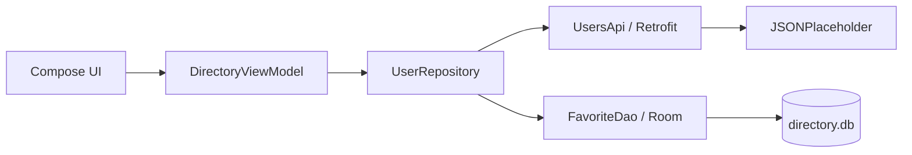

# Informe técnico — Directorio de usuarios

## Arquitectura MVVM



La UI observa un `StateFlow` del ViewModel. El repositorio encapsula la red y Room, convierte respuestas HTTP no exitosas en errores y captura `IOException` para mostrar un estado sin conexión.

## Retrofit

```kotlin
interface UsersApi {
    @GET("users") suspend fun getUsers(): Response<List<User>>
    @GET("posts") suspend fun getPosts(@Query("userId") userId: Int): Response<List<Post>>
}
```

## Room

```kotlin
@Dao
interface FavoriteDao {
    @Query("SELECT * FROM favorites ORDER BY name")
    fun observeAll(): Flow<List<FavoriteEntity>>
    @Upsert suspend fun upsert(favorite: FavoriteEntity)
    @Query("DELETE FROM favorites WHERE id = :id") suspend fun delete(id: Int)
}
```

## Ciclo de vida y carga

`MainActivity` crea el repositorio desde `DirectoryApplication` y obtiene el ViewModel con `viewModel()`. El ViewModel inicia la observación de favoritos y solicita usuarios en `viewModelScope`, que se cancela cuando el ViewModel se destruye. La pantalla de detalle vuelve a solicitar publicaciones cuando cambia el usuario seleccionado.

## Verificación realizada

- Compilación `assembleDebug`: **exitosa**.
- APK instalado en `Medium_Phone_API_36.1`: **exitosa**.
- Lista remota de usuarios: **verificada visualmente** en `pantalla-exito.png`.
- Detalle y publicaciones: **verificados visualmente** en `pantalla-detalle.png`.
- La primera ejecución detectó un desajuste de namespace; se corrigió y se recompiló con éxito.
- Favoritos, persistencia offline y error/sin conexión: no se certifican en esta sesión porque el AVD mostró `System UI isn't responding` durante la automatización.

## Conclusiones

La implementación separa responsabilidades y cubre la integración Retrofit/Room solicitada. La compilación y los dos flujos principales fueron validados en un emulador real. Queda pendiente repetir la matriz completa de cinco escenarios en un AVD estable para certificar carga, error, favoritos y persistencia offline.

Repositorio GitHub: pendiente de publicación autorizada.
